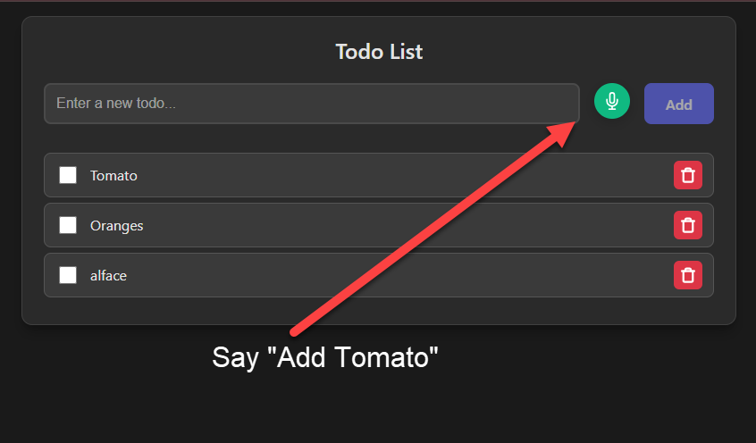

# GroceryListAI

A full-stack web application that combines grocery list management with an AI assistant. Users manage their shopping list directly or by typing/speaking natural-language commands, which an LLM (ChatGPT or a local Ollama model) turns into actions on the list.


## Voice Control



GroceryListAI supports **voice commands** — just click the microphone icon and speak naturally. The AI understands your intent and updates the list automatically.

**Example commands:**

| Voice Command | Action |
|---|---|
| "Add Tomato" | Adds Tomato to the list |
| "Remove Tomato" | Removes Tomato from the list |
| "Check Tomato" | Marks Tomato as purchased |

The app works in **English and Portuguese** — just speak in your preferred language. The language can be configured in the settings.

## Table of Contents

- [Features](#features)
- [Technology Stack](#technology-stack)
- [Project Structure](#project-structure)
- [Getting Started](#getting-started)
- [Configuration](#configuration)
- [Commands](#commands)
- [Testing](#testing)
- [API](#api)
- [Contributing](#contributing)

## Features

- **Multiple lists** — create, rename and delete lists (e.g. "General", "Pharmacy") and switch between them from a dropdown; everything you do applies to the selected list.
- **Grocery list** — add, delete, check and uncheck items; checked items are shown in a separate list.
- **AI assistant** — natural-language commands handled by an LLM with tool calling (add, remove, check, uncheck), with the reply streamed back.
- **Voice input** — Web Speech API, English and Portuguese.
- **Multiple LLM providers** — OpenAI ChatGPT or local Ollama models, chosen via environment variables.
- **Multiple databases** — SQLite or PostgreSQL; schema migrations run automatically on startup.
- **Dark and light themes.**

## Technology Stack

| Layer | Technology |
|---|---|
| Backend | .NET 10, ASP.NET Core (controllers), Serilog |
| Data | Entity Framework Core 10 — SQLite or PostgreSQL (Npgsql) |
| AI | Microsoft Semantic Kernel — OpenAI and Ollama connectors |
| Local orchestration | .NET Aspire (AppHost + ServiceDefaults) |
| Backend tests | xUnit, `WebApplicationFactory`, in-memory SQLite |
| Frontend | React 19, TypeScript 5.9, Vite 7, React Router 7 (`HashRouter`), Axios, react-toastify |
| Deployment | Docker, Docker Compose, nginx |

## Project Structure

```
GroceryListAi/
├── src/
│   ├── Server/                          # .NET backend (GroceryListAi.slnx)
│   │   ├── GroceryListAi.Api/           # ASP.NET Core API — controllers, DTOs, Program.cs
│   │   ├── GroceryListAi.Core/          # EF Core DbContext, models, migrations, services, LLM plugin
│   │   ├── GroceryListAi.AppHost/       # .NET Aspire host for local development
│   │   ├── GroceryListAi.ServiceDefaults/
│   │   ├── GroceryListAi.Tests/         # xUnit integration tests
│   │   └── Dockerfile
│   ├── Web/                             # React + TypeScript frontend
│   │   ├── src/
│   │   │   ├── Pages/                   # Home, Settings, Tests
│   │   │   ├── components/              # ListSelector, TodoList, Chat, Sidebar, VoiceButton, Footer, icons
│   │   │   ├── contexts/                # ThemeContext
│   │   │   └── api.ts                   # API client
│   │   └── Dockerfile
│   └── Legacy/                          # Archived Python/FastAPI backend (not used)
├── docs/                                # Plans, tasks, feature docs, HTML prototypes, API contract
├── docker-compose.yml
├── build-web-linux.sh / build-web-windows.bat
└── .env.example
```

## Getting Started

### Prerequisites

- [.NET 10 SDK](https://dotnet.microsoft.com/download)
- Node.js 20+ and npm
- An OpenAI API key, or [Ollama](https://ollama.com) running locally
- Optional: Docker (for Docker Compose or the Aspire AppHost)

### Run locally

```bash
# 1. Configure — copy the template and fill in the values (see Configuration)
cp .env.example .env

# 2. Backend
cd src/Server
dotnet run --project GroceryListAi.Api        # http://localhost:5071

# 3. Frontend (another terminal)
cd src/Web
npm install
npm run dev                                   # http://localhost:81
```

Point the frontend at the API with `VITE_API_URL` (defaults to `http://localhost:8000`), and add the frontend's address to `CORS_ORIGINS`.

### Run with .NET Aspire

Starts PostgreSQL, the API and the frontend together (requires Docker):

```bash
cd src/Server
dotnet run --project GroceryListAi.AppHost
```

### Run with Docker Compose

```bash
docker-compose up -d --build
```

The backend is published on `API_PORT` and the frontend on `FRONTEND_PORT`.

## Configuration

The backend reads environment variables, loaded from the nearest `.env` file (the repository root `.env` for Docker Compose). Use `.env.example` as the template. With Docker Compose, set every variable below: a variable missing from `.env` reaches the container as an empty string, and an empty `DATABASE_PROVIDER` stops the backend at startup.

| Variable | Description |
|---|---|
| `DATABASE_PROVIDER` | `sqlite` (default) or `postgres` |
| `CONNECTION_STRING` | Required. e.g. `Data Source=grocerylist.db` or `Host=...;Database=...;Username=...;Password=...` |
| `LLM` | `chatgpt` or `ollama` |
| `MODEL` | Model name, e.g. `gpt-4o-mini` or `llama3` |
| `OPENAI_API_KEY` | Required when `LLM=chatgpt` |
| `CORS_ORIGINS` | Comma-separated list of allowed frontend origins |
| `API_PORT` | Backend port (Docker) |
| `FRONTEND_PORT` | Frontend port (Docker) |
| `VITE_API_URL` | Base URL the frontend uses to reach the API |

Ollama is expected at `http://localhost:11434`.

## Commands

### Backend (`src/Server/`)

```bash
dotnet build GroceryListAi.slnx
dotnet test GroceryListAi.slnx
dotnet run --project GroceryListAi.Api
dotnet run --project GroceryListAi.AppHost
dotnet ef migrations add <Name> --project GroceryListAi.Core --startup-project GroceryListAi.Api
```

### Frontend (`src/Web/`)

```bash
npm run dev       # Development server (port 81)
npm run build     # Type-check and production build
npm run preview   # Preview the production build
npm run lint      # ESLint
```

### Docker (repository root)

```bash
docker-compose up -d --build
docker-compose down
./build-web-linux.sh          # or build-web-windows.bat — rebuild the frontend container
```

## Testing

```bash
cd src/Server
dotnet test GroceryListAi.slnx
```

The integration tests run the API in memory against an in-memory SQLite database and a fake chat completion service, so no database server or LLM is needed. The migration tests also generate the full PostgreSQL migration script, which catches Postgres-only migration errors without a Postgres server. The frontend has no automated tests; `npm run lint` checks code quality.

## API

| Method | Path | Description |
|---|---|---|
| GET | `/health` | Health check |
| GET | `/api/lists` | List all lists |
| POST | `/api/lists` | Create a list |
| PUT | `/api/lists/{id}` | Rename a list |
| DELETE | `/api/lists/{id}` | Delete a list and its items (not the last one) |
| GET | `/api/items?listId=` | List the items of a list |
| POST | `/api/items` | Create an item in a list |
| PATCH | `/api/items/{id}/checked` | Set an item's checked state |
| DELETE | `/api/items/{id}` | Delete an item |
| POST | `/api/chat` | Send a message to the assistant about a list; the reply is streamed |

Request and response details: [docs/API_CONTRACT.md](docs/API_CONTRACT.md).

## Contributing

Contributions are welcome! Follow these guidelines:

1. **Fork the repository**
2. **Create a feature branch**: `git checkout -b feature/your-feature`
3. **Make your changes** with clear, descriptive commits
4. **Test your changes** thoroughly
5. **Push to your branch**: `git push origin feature/your-feature`
6. **Open a Pull Request** with a detailed description

## License

MIT License
