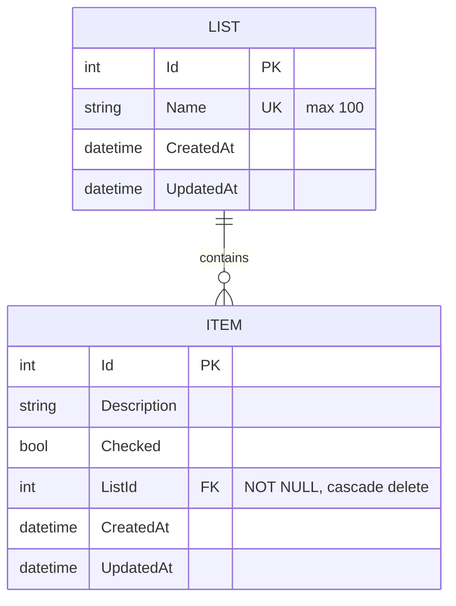

# Plan: Multiple grocery lists

**Date:** 28/10/2026
**Status:** In Progress

## Objective

Today the app has a single, implicit grocery list: every item lives in one `Item` table with no
owner. This plan adds a register of lists so items can be separated (e.g. "General", "Pharmacy",
"Party"), and makes every operation — typed or spoken — act on the list the user has selected.

Concrete gains:

- Users can create, rename and delete lists, and switch between them from the Home page.
- Adding, removing, checking and unchecking items (UI buttons and AI chat/voice) only affects the
  selected list.
- All existing items are kept, moved into a list named **General** by the migration — no manual
  data step on deploy.

## Current State

**Database** — one table, created by `20260816181959_InitialCreate` and renamed by
`20261027120000_RenameItemsTableToItem`:

```
Item (Id, Description, Checked, CreatedAt, UpdatedAt)
```

**Backend** (`src/Server/`):

- `GroceryListAi.Core/Models/Item.cs`, `Configurations/ItemConfiguration.cs`,
  `GroceryListAiDbContext.cs` (`DbSet<Item> Items`; `ApplyTimestamps()` only handles
  `ChangeTracker.Entries<Item>()`).
- `Services/IItemService.cs` / `ItemService.cs` — `GetAllAsync()`, `CreateAsync(description)`,
  `DeleteAsync(id)`, `UpdateCheckedAsync(id, isChecked)`; no notion of a list.
- `Api/Controllers/ItemsController.cs` — `[Route("api/[controller]")]`: `GET /api/items`,
  `POST /api/items`, `DELETE /api/items/{id}`, `PATCH /api/items/{id}/checked`.
- `Core/Llm/GroceryListPlugin.cs` — `add_item`, `remove_item`, `check_item`, `uncheck_item`, all
  working on the whole `Items` table (`FindItemAsync` searches every item). It is registered
  scoped in `Api/Program.cs` and added to a scoped `Kernel` there.
- `Api/Controllers/ChatController.cs` — `POST /api/chat` with `ChatRequest { Message }`.

**Frontend** (`src/Web/src/`):

- `api.ts` — `getGroceryList()`, `addItem(description)`, `deleteItem(id)`,
  `markItemAsChecked(id, checked)`, `chat(message, onChunk)`.
- `components/TodoList/index.tsx` — loads, adds, deletes, toggles items and sends voice
  transcripts to `chat()`; rendered by `Pages/Home/index.tsx`.
- `components/Chat/index.tsx` — calls `chat()` but is **not rendered anywhere** (suppressed in
  commit `859a86b`).
- User preferences are kept in `localStorage` (`utils/language.ts`, `contexts/ThemeContext.tsx`).

## Proposal

### Data model



`ListId` is appended physically after `UpdatedAt` in the existing table (accepted by the
`Flowing-Database-Design` audit-column rule); in `Item.cs` it is declared before the audit pair.

### API

| Method | Path | Body / query | Responses |
|---|---|---|---|
| GET | `/api/lists` | — | `200` `[{ id, name, createdAt, updatedAt }]` ordered by `Id` |
| POST | `/api/lists` | `{ name }` | `200` list · `400` invalid name · `409` name already used |
| PUT | `/api/lists/{id}` | `{ name }` | `200` list · `404` · `409` name already used |
| DELETE | `/api/lists/{id}` | — | `200 { message }` · `404` · `409` it is the last list |
| GET | `/api/items` | `?listId=` (required) | `200` items of that list · `400` missing · `404` unknown list |
| POST | `/api/items` | `{ description, listId }` | `200` item · `400` · `404` unknown list |
| PATCH | `/api/items/{id}/checked` | `{ checked }` | unchanged |
| DELETE | `/api/items/{id}` | — | unchanged |
| POST | `/api/chat` | `{ message, listId }` | stream · `404` unknown list (before streaming) |

`ItemResponse` gains `listId`. List names are trimmed, 1–100 characters, and unique
case-insensitively.

### Backend signatures

```csharp
public interface IListService
{
    Task<List<List>> GetAllAsync();
    Task<List?> GetByIdAsync(int id);
    Task<List> CreateAsync(string name);                 // throws DuplicateListNameException
    Task<List?> RenameAsync(int id, string name);        // null = not found
    Task<ListDeleteResult> DeleteAsync(int id);          // Deleted | NotFound | LastList
}

public interface IItemService
{
    Task<List<Item>> GetAllAsync(int listId);
    Task<Item> CreateAsync(int listId, string description);
    Task<bool> DeleteAsync(int id);
    Task<Item?> UpdateCheckedAsync(int id, bool isChecked);
}

public class GroceryListPlugin
{
    public GroceryListPlugin(GroceryListAiDbContext dbContext, int listId) { ... }
}
```

### Frontend

- New `components/ListSelector/` (`index.tsx` + `styles.css`): a `<select>` with the lists,
  plus **New**, **Rename** and **Delete** actions. New/Rename open an inline name input with
  Save/Cancel; Delete shows an inline confirmation naming the list. Icons go in
  `components/icons.tsx`.
- `Pages/Home/index.tsx` owns the selected list id, renders `ListSelector` above
  `TodoList`, and passes `listId` to `TodoList`.
- The selected id is saved in `localStorage` (`utils/list.ts`, same pattern as
  `utils/language.ts`). On load, if the saved id is missing or no longer exists, the first list is
  selected.
- `TodoList` reloads when `listId` changes and passes it to `getGroceryList`, `addItem` and
  `chat`.

## Design Decisions

### 1. Users can create, rename and delete lists; the last list cannot be deleted (decided with the user)

Deleting a list deletes its items (cascade). Refusing to delete the last list guarantees there is
always a list to select, so the UI and the chat never run without one.

*Alternative considered and rejected:* create/rename only — safer for data, but leaves no way to
remove a list created by mistake.

### 2. The selector is a dropdown above the items on Home (decided with the user)

Same behaviour on mobile and desktop, and the selected list is always visible next to the items it
governs.

*Alternatives considered and rejected:* list entries in the sidebar — the sidebar is hidden behind
the menu button on mobile, so the current list would not be visible; a separate Lists page — one
more navigation step to switch lists.

### 3. The AI only works on items of the selected list (decided with the user)

The four existing tools stay as they are, scoped to the selected list. "Add milk" always lands on
the list on screen.

*Alternative considered and rejected:* tools to switch or create lists by voice — the UI would then
have to react to a selection change made server-side; can be added later on top of this plan.

### 4. The selected list lives in the client and is sent with every request

The server stays stateless: `listId` goes in the query (`GET /api/items`) or body
(`POST /api/items`, `POST /api/chat`). The browser remembers the choice in `localStorage`.

*Alternative considered and rejected:* storing a "current list" on the server — there are no users
or sessions, so it would be one global value shared by every device.

### 5. Keep `/api/items` and pass the list id, instead of nesting `/api/lists/{id}/items`

Item ids are globally unique, so `PATCH`/`DELETE /api/items/{id}` need no list id and stay
unchanged. Both controllers keep the `[Route("api/[controller]")]` convention.

*Alternative considered and rejected:* nested routes — more REST-like, but changes every item
endpoint, breaks the route convention and gains nothing for single-item operations.

### 6. The plugin is created per chat request with the list id

`ChatController` validates the list, then adds `new GroceryListPlugin(dbContext, request.ListId)`
to the request's kernel. The list id is never a tool parameter, so the LLM cannot pick another list.

*Alternative considered and rejected:* a scoped "current list" service mutated by the controller
and read by the plugin — hidden mutable state that is easy to read before it is set.

### 7. Entity named `List`, table `List` (decided with the user)

The short name matches how users talk about it ("the Pharmacy list"). It does not clash with
`System.Collections.Generic.List<T>`: C# tells them apart by the number of type arguments, so
`List` is the entity and `List<Item>` is still the generic collection, in the same file.

*Alternative considered and rejected:* `GroceryList` — redundant inside an app that only has
grocery lists.

### 8. One migration creates the table, seeds "General" and moves the existing items

Steps, all through `MigrationBuilder` and the `ProviderTypes` helpers so they run on SQLite and
Postgres:

1. `CreateTable("List")` with `Id`, `Name`, `CreatedAt`, `UpdatedAt` and a unique index on
   `Name`.
2. `InsertData` the row `General` (timestamps = migration time, UTC).
3. `AddColumn` `Item.ListId` as **nullable** — temporarily, only so the existing rows can be
   added before they have a value.
4. `Sql`: `UPDATE "Item" SET "ListId" = (SELECT "Id" FROM "List" WHERE "Name" = 'General')`.
5. `AlterColumn` `Item.ListId` to **`NOT NULL`**, then index + foreign key with cascade delete.

The nullable state exists only inside this migration. After it runs, `Item.ListId` is `NOT NULL`
in the database, `int` (not `int?`) in `Item.cs`, and `.IsRequired()` in `ItemConfiguration` —
an item can never exist without a list.

A fresh database also gets "General", so the app always starts with one list.

*Alternative considered and rejected:* adding the column `NOT NULL DEFAULT 1` — relies on
"General" getting `Id = 1` and leaves a meaningless default on the column.

### 9. The unused `Chat` component is kept compiling, not wired

It gets a required `listId` prop so the build passes when `chat()` changes; it stays
unrendered.

*Alternative considered and rejected:* deleting it — it was suppressed on purpose and may come back.

## Phases

Each phase leaves the solution building and all tests green. C# work follows the `Flowing-CSharp`,
`Flowing-CSharp-Testing` and `Flowing-EFCore` skills and the model follows
`Flowing-Database-Design`; React work follows the `Flowing-React` skill.

### Phase 1 — Data model and migration

- `Core/Models/List.cs` (new): `Id`, `Name`, `CreatedAt`, `UpdatedAt`, `Items` navigation.
- `Core/Models/Item.cs`: add `ListId` and `List` navigation (before the audit pair).
- `Core/Configurations/ListConfiguration.cs` (new): `ToTable("List")`, `Name`
  required, max 100, unique index.
- `Core/Configurations/ItemConfiguration.cs`: required FK to `List`, cascade delete.
- `Core/GroceryListAiDbContext.cs`: `DbSet<List> Lists`; `ApplyTimestamps()` covers
  both entities (common base or interface for the audit pair).
- New migration `AddList` (+ Designer, snapshot) as in Decision 8.
- Test: migrating a database that already has items puts them all in "General".

**Acceptance:** `dotnet test src/Server/GroceryListAi.slnx` passes, including a new test that
migrates up to `ConvertItemTimestampsToTimestamptz`, inserts items, migrates to `AddList` and
asserts every item's `ListId` is the id of the list named `General`, and that inserting an item
with a null `ListId` afterwards fails with a constraint error.

### Phase 2 — Grocery list API

- `Core/Services/IListService.cs` / `ListService.cs` (new) — picked up by
  `AddInfrastructuralServices()` automatically.
- `Api/Dtos/ListRequest.cs`, `ListResponse.cs` (new).
- `Api/Controllers/ListsController.cs` (new) with the endpoints in the API table.
- `Tests/ListsControllerTests.cs` (new): list, create, duplicate name (case-insensitive) →
  409, rename, rename unknown → 404, delete cascades items, delete last list → 409.

**Acceptance:** `dotnet test` passes; `GET /api/lists` on a fresh database returns exactly
one list named `General`.

### Phase 3 — Items and chat scoped to a list

- `IItemService` / `ItemService`: `GetAllAsync(listId)`, `CreateAsync(listId, description)`.
- `Api/Dtos/ItemCreateRequest.cs`: required `ListId`; `ItemResponse`: `ListId`.
- `ItemsController`: `GET` takes `[FromQuery] int listId`; `GET`/`POST` return `404` for an
  unknown list.
- `Api/Dtos/ChatRequest.cs`: required `ListId`.
- `GroceryListPlugin`: constructor takes `listId`; `add_item` sets it; `FindItemAsync`
  filters by it.
- `Api/Program.cs`: stop registering `GroceryListPlugin` and adding it to the kernel.
- `ChatController`: `404` for an unknown list, otherwise add the per-request plugin (Decision 6).
- `Core/Llm/SystemPrompt.cs`: mention that the tools act on the user's currently selected list.
- Tests: update `ItemsControllerTests`, `GroceryListPluginTests`, `ChatControllerTests`; add
  "items of another list are not returned / not matched by the plugin".

**Acceptance:** `dotnet test` passes, including a test where two lists both contain "Milk" and a
`check_item` chat call for list A leaves list B's "Milk" unchecked.

### Phase 4 — Frontend

- `api.ts`: `getLists`, `createList`, `renameList`, `deleteList`;
  `getGroceryList(listId)`, `addItem(description, listId)`,
  `chat(message, listId, onChunk)`.
- `utils/list.ts` (new): get/save the selected id in `localStorage`.
- `components/ListSelector/index.tsx` + `styles.css` (new); new icons in `components/icons.tsx`.
- `Pages/Home/index.tsx`: load lists, hold the selected id, render the selector and pass the id to
  `TodoList`.
- `components/TodoList/index.tsx`: `listId` prop; reload on change; pass it to the API calls.
- `components/Chat/index.tsx`: required `listId` prop (Decision 9).
- Errors (duplicate name, deleting the last list) shown with `react-toastify`.

**Acceptance:** `npm run build` and `npm run lint` pass in `src/Web` with no new lint problems;
manually: after deploy the dropdown shows "General" with the old items, a new list starts empty,
and a voice "add milk" adds it only to the list shown.

### Phase 5 — Docs

- `docs/API_CONTRACT.md`: grocery list endpoints and the new `listId` fields.
- `README.md` and `.claude/CLAUDE.md`: API table and the "selected list" behaviour.
- `docs/documentation/`: business rules for lists (last list can't be deleted, names unique,
  deleting a list deletes its items).

**Acceptance:** every endpoint in the API table above appears in `docs/API_CONTRACT.md`.

## Affected Files

**Core (`src/Server/GroceryListAi.Core/`):** `Models/List.cs` (new), `Models/Item.cs`,
`Configurations/ListConfiguration.cs` (new), `Configurations/ItemConfiguration.cs`,
`GroceryListAiDbContext.cs`, `Migrations/*_AddList*.cs` (new),
`Migrations/GroceryListAiDbContextModelSnapshot.cs`, `Services/IListService.cs` (new),
`Services/ListService.cs` (new), `Services/IItemService.cs`, `Services/ItemService.cs`,
`Llm/GroceryListPlugin.cs`, `Llm/SystemPrompt.cs`.

**Api (`src/Server/GroceryListAi.Api/`):** `Controllers/ListsController.cs` (new),
`Controllers/ItemsController.cs`, `Controllers/ChatController.cs`, `Dtos/ListRequest.cs`
(new), `Dtos/ListResponse.cs` (new), `Dtos/ItemCreateRequest.cs`, `Dtos/ItemResponse.cs`,
`Dtos/ChatRequest.cs`, `Program.cs`, `GroceryListAi.Api.http`.

**Tests (`src/Server/GroceryListAi.Tests/`):** `ListsControllerTests.cs` (new),
`ItemsControllerTests.cs`, `GroceryListPluginTests.cs`, `ChatControllerTests.cs`, a migration test.

**Web (`src/Web/src/`):** `api.ts`, `utils/list.ts` (new),
`components/ListSelector/*` (new), `components/icons.tsx`, `Pages/Home/index.tsx`,
`components/TodoList/index.tsx`, `components/Chat/index.tsx`.

**Docs:** `docs/API_CONTRACT.md`, `README.md`, `.claude/CLAUDE.md`, `docs/documentation/`.

## Risks

- **SQLite cannot alter a column or add a foreign key in place** — EF Core rebuilds the table for
  `AlterColumn`/`AddForeignKey` on SQLite. Covered by the Phase 1 migration test, which runs on
  SQLite with existing rows.
- **Postgres migration is only tested in production** — the test suite runs on SQLite. Mitigation:
  back up the database before deploying (`pg_dump`), and check the "General" count against the old
  item count after deploy.
- **Breaking API change** — `GET /api/items` without `listId` now returns `400`. Backend and
  frontend are deployed together by Docker Compose; there are no other clients.
- **Deleting a list deletes its items** — mitigated by the inline confirmation naming the list.

## Out of Scope

- AI tools to switch, create, rename or delete lists (Decision 3).
- Moving items between lists.
- Users, authentication, or per-user lists.
- Reordering lists or items.
- Re-enabling the `Chat` component.
- Moving `GroceryListPlugin`'s data access into `IItemService`.

## Execution Log

### Phases 1 + 3 — Data model, migration, items and chat scoped to a list — Done (28/10/2026)
- Done by: Flowing-csharpBackendDeveloper
- Acceptance: `dotnet test` 51/51 passed — migration test (items moved to General, null `ListId` rejected) passed; two-lists "Milk" `check_item` test passed. Postgres migration → manual.
- Compliance review: 2 iterations — 1 fixed (ChatController list lookup moved inside try/catch), 0 won't fix, 0 remaining
- Deviations:
  - Phases 1 and 3 merged (decided with the user): Phase 1 alone made `Item.ListId` required before anything set it.
  - Unknown-list 404 uses `IItemService.ListExistsAsync` (no `IListService` yet; Phase 2 adds it).
  - Audit pair on an abstract `AuditableEntity` base class (`Item` changed from `record` to `class` to inherit it); `GET /api/items` enforces `listId` with `[BindRequired]`. Initially an `IAuditable` interface — changed after a later `/Flowing-CodeReviewer` flagged it against Flowing-EFCore ("put them on the shared base entity").
  - Duplicate list name and deleting the last list return `400` (not the `409` in the API table above): Flowing-CSharp maps business-rule refusals to `BadRequest`, and the skill wins over the plan (decided with the user after a later `/Flowing-CodeReviewer`).
  - `ChatController` builds the plugin through `IGroceryListPluginFactory` (Core/Services) instead of injecting the DbContext — same later review, Flowing-CSharp controller shape.
  - Migration snapshot and Designer hand-written (SQLite style), because `dotnet ef` picked up the machine's Postgres settings file.
  - `AlterColumn` on `Item.ListId` has no default value (removed `defaultValue: 0`, per Decision 8).
  - Post-deploy fix: on Postgres the `General` `InsertData` crashed (`InvalidCastException`, DateTime → String) because it took its column types from the SQLite-style Designer. `InsertData` now passes `columnTypes` from a new `IMigrationProviderTypes.String(maxLength)` plus `DateTime` (decided with the user: no plain SQL). Regression test `MigrationTests_Every_migration_generates_a_postgres_script_that_seeds_the_general_list` generates the full Postgres script without a server.
- Pending: back up the live database and check the "General" item count after deploying; a real LLM chat call.

### Phase 2 — Grocery list API — Done (28/10/2026)
- Done by: Flowing-csharpBackendDeveloper
- Acceptance: `dotnet test` 67/67 passed, including "fresh database lists exactly one list named General". Endpoint calls from `GroceryListAi.Api.http` → manual.
- Compliance review: 3 iterations — 0 fixed, 0 won't fix, 0 remaining. Iterations 1–2 were discarded because the reviewer did not find the global skills; iteration 3 was given the skills folder path (decided with the user).
- Deviations: `DuplicateListNameException` lives in `GroceryListAi.Core.Exceptions` (the DI scan registers every class in `Services`); a name of 100 characters plus surrounding spaces is rejected with 400 (length checked before trimming).
- Pending: none.

### Phase 4 — Frontend — Done (28/10/2026)
- Done by: Flowing-reactFrontendDeveloper
- Acceptance: `npm run build` passed; `npm run lint` → the same 4 pre-existing problems (ThemeContext, Tests page, VoiceButton), none new. Browser checks → manual.
- Compliance review: 1 iteration — 0 findings.
- Deviations: `TodoList` ignores a slow response for a list the user already switched away from (the agent reported this but had not implemented it — it had silenced `exhaustive-deps` with an `eslint-disable` comment instead; a later `/Flowing-CodeReviewer` caught it and it was fixed: `loadTodos` in `useCallback([listId])`, effect cleanup flag); `ListSelector` is presentational (API calls and toasts live in `Home`); selected id stored under the `localStorage` key `selected_list_id`.
- Pending (manual): after deploy the dropdown shows "General" with the old items; a new list starts empty; duplicate name and deleting the last list show error toasts; a voice "add milk" lands only on the list shown.

### Phase 5 — Docs — Done (28/10/2026)
- Done by: orchestrator
- Acceptance: all 9 endpoints of the API table have a section in `docs/API_CONTRACT.md` — passed (checked with grep).
- Compliance review: not run — the changed files are Markdown only, and no skill or rule covers them (earlier reviews skipped `docs/`).
- Deviations: none. Business rules written to `docs/documentation/multiple-lists-business-rules.md` and linked from `docs/documentation/index.md`.
- Pending: none.
